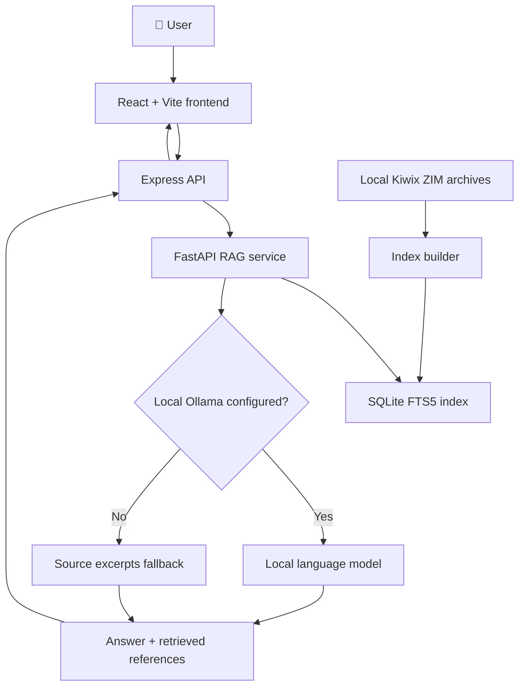

🌐 OFF-LINE
Your emergency companion. Even without the internet.

  <strong>An offline-first emergency information platform powered by Kiwix, local search, and optional on-device AI.</strong>

  
  
  
  
  

<a href="#-the-idea">The Idea</a> •
<a href="#-features">Features</a> •
<a href="#-how-it-works">How It Works</a> •
<a href="#-quick-start">Quick Start</a> •
<a href="#-safety-first">Safety</a>

[!IMPORTANT]
OFF-LINE is a development starter, not a certified emergency response system. Content availability depends on the ZIM archives and datasets installed locally. Verify emergency contacts and facility records with official sources. AI output can be wrong. In an actual emergency, contact the appropriate local emergency service whenever possible.

🚨 The idea
When the network disappears, reliable information can become difficult to access. OFF-LINE is designed to make locally stored emergency information searchable without depending on a live cloud AI service.

Choose a category, explore a situation, ask a question, and review the retrieved source excerpts. If a compatible local Ollama model is installed and configured, the system can also attempt to generate a grounded answer from retrieved passages.

     YOU ASK  →  OFF-LINE SEARCHES LOCAL KNOWLEDGE
                         ↓
              RETRIEVED SOURCE PASSAGES
                         ↓
            OPTIONAL LOCAL AI GENERATION
                         ↓
              ANSWER + SOURCE REFERENCES

✨ Features
Feature	What it does
📚 Offline knowledge	Indexes locally supplied Kiwix .zim archives for local retrieval.
🔎 Local search	Uses SQLite FTS5 for full-text passage retrieval.
🧭 Guided exploration	Navigate from category to topic to a question.
🤖 Optional local AI	Can use a pre-downloaded Ollama model to generate a grounded response.
📖 Source excerpts	Returns retrieved passages when generation is unavailable.
🗺️ Emergency map foundation	Frontend map components and API routes can support mapped facility discovery when valid local data is available.
🔊 Read answers aloud	Uses browser speech synthesis; audio is opt-in.
🧩 Modular services	React frontend, Express API and FastAPI retrieval service run separately.

Offline does not happen automatically. ZIM archives, the search index, model files, dependencies, map tiles and facility records must be prepared and tested in advance. A map that uses online tiles or an external geocoder may still need internet access.

🧱 Architecture

Stack
- Frontend: React, Vite, React Router, CSS and Leaflet-based map components.
- API: Node.js and Express.
- Retrieval: Python, FastAPI, SQLite FTS5.
- Knowledge source: User-provided Kiwix .zim archives, indexed locally.
- Optional generation: Ollama with a model already downloaded on the device.
- Voice: Browser speech synthesis.
🔄 How it works
1. Prepare knowledge: place the ZIM archives you have permission to use in data/zims/.
2. Build the index: scripts/build-index.py invokes zimdump to extract articles and indexes available text into SQLite.
3. Ask a question: the frontend sends the question and relevant category/topic filters to the Express API.
4. Retrieve passages: FastAPI searches the local SQLite FTS5 index.
5. Generate or fall back: if local Ollama generation is configured and available, the service attempts grounded generation; otherwise it returns retrieved source excerpts.
6. Inspect the evidence: the UI should expose source information so users can check where an answer came from.
🧰 Prerequisites
Install these before starting:
- Node.js LTS
- Python 3.11 or newer
- Kiwix-tools with zimdump and, if article browsing is needed, kiwix-serve
- Optional: Ollama and a compatible model downloaded locally
- Sufficient disk space for extracted ZIM content, the SQLite index and any local model
Check that the command-line tools are available:
node --version
npm --version
py --version
zimdump --help
kiwix-serve --help
🚀 Quick start (Windows PowerShell)
Run these commands from the repository root.
1. Install dependencies
npm install
npm --prefix frontend install
npm --prefix backend install

py -m venv .venv
.\.venv\Scripts\python.exe -m pip install -r rag-service\requirements.txt
2. Add your offline knowledge
Put the .zim archives you have permission to use inside:
data/
└── zims/
    ├── your-knowledge-file.zim
    └── another-archive.zim
The filenames above are examples. Do not expect the index to contain articles until you supply archives and successfully build it.
3. Build the local search index
.\.venv\Scripts\python.exe scripts\build-index.py
Expected index location:
data/index/emergency.sqlite3
Indexing can take a long time and extraction can require substantially more disk space than the original ZIM. If extraction fails, inspect zimdump --help; command options vary by Kiwix-tools version.
4. Start the services
Open three separate PowerShell terminals at the project root.

Terminal A — FastAPI RAG service
.\.venv\Scripts\python.exe -m uvicorn app.main:app --app-dir rag-service --host 127.0.0.1 --port 8000 --reload
Terminal B — Express API
npm --prefix backend run dev
Terminal C — React frontend
npm --prefix frontend run dev
Open the local URL printed by Vite, usually:
http://localhost:5173
If a service exits, read the first error before the shutdown messages. A successful /health response confirms only that the health endpoint responded at that moment; it does not prove indexing, retrieval, map caching or local AI are working.
📖 Optional: browse ZIM articles with Kiwix
To serve a local archive, run:
kiwix-serve --port=8080 data\zims\your-file.zim
The repository describes a /kiwix/ Vite proxy for the browser UI. Confirm that the proxy target and Kiwix server configuration match your installed version. For multiple archives, consult kiwix-serve --help.
🧠 Optional: local AI with Ollama
Local generation is optional. It must not be required for basic search or source-excerpt fallback.
1. Install Ollama.
2. Download a model suitable for your device before going offline.
3. Configure the model setting expected by rag-service/app/config.py (the project uses OLLAMA_MODEL).
4. Start Ollama and verify that the configured model is available.
5. Test with the internet disconnected.
Model size, quantization, available RAM/VRAM and context length affect latency and answer quality. Do not claim a particular response time or accuracy without measuring it on the target device.
🗺️ Emergency facility data
The repository may include facility API routes, map components or data-update scripts. Those features are useful only when backed by real, appropriately licensed and validated data.

Before field use, verify:
- Facility name, address and coordinates.
- Phone numbers, operational status and opening hours.
- Whether the facility actually provides the required emergency service.
- Dataset source, update date and redistribution rights.
- Offline map tiles, routing data and licensing/attribution requirements.
Do not use fabricated/demo coordinates as real emergency locations. A nearby map pin is not proof that a facility is open or equipped for a specific emergency.
🧪 Offline test checklist
Test on the same device and hardware intended for deployment.
- [ ] Install all dependencies and download all archives/models first.
- [ ] Build the SQLite index and confirm that it contains documents.
- [ ] Start all three services and verify their health endpoints.
- [ ] Ask questions that have clear answers in the local source material.
- [ ] Ask questions that are not covered and confirm a safe fallback is returned.
- [ ] Inspect source references and confirm they point to retrieved material.
- [ ] Turn off Wi-Fi and mobile data, then repeat search and article browsing tests.
- [ ] Confirm that map tiles, facility data and any required assets are actually cached locally.
- [ ] Measure startup time, retrieval latency, generation latency, memory and disk use.
- [ ] Have qualified reviewers validate emergency-related content before deployment.
🔐 Safety first
- Retrieval quality depends on the archives, extraction quality and index.
- Local language models can hallucinate even when supplied with relevant passages.
- A citation is useful only if it genuinely supports the answer.
- When retrieval is weak, missing or irrelevant, return a clear fallback instead of inventing emergency instructions.
- Do not present the app as a replacement for emergency dispatchers, clinicians, fire services or police.
- Keep verified emergency contacts available in a prominent, accessible interface.
🗂️ Project layout
.
├── backend/                 # Express API and routes
├── frontend/                # React + Vite application
├── rag-service/             # FastAPI retrieval and optional generation
├── scripts/
│   ├── build-index.py       # Extract and index ZIM article text
│   ├── run-index.js         # Indexing helper
│   ├── dev-rag.js           # RAG development helper
│   ├── cache-emergency-tiles.js
│   └── update-facilities.js
└── data/
    ├── zims/                # Add your ZIM archives here
    └── index/               # Generated SQLite index
Some paths or helper scripts may differ as the project evolves; check the repository before running optional helpers.
🤝 Contributing
1. Fork the repository.
2. Create a feature branch.
3. Make a focused change and test it.
4. Document data sources, licensing and offline requirements.
5. Open a pull request with the test steps and limitations.
📜 Data, licensing and attribution
Respect the license of every ZIM archive, dataset, map tile source, model and dependency you use. Include required attribution and redistribution notices. Do not bundle copyrighted archives unless their license permits redistribution.

Built for resilience. Designed for disconnected moments. 🌍
OFF-LINE — Emergency knowledge, available locally.

Development project • Validate before real-world emergency use

